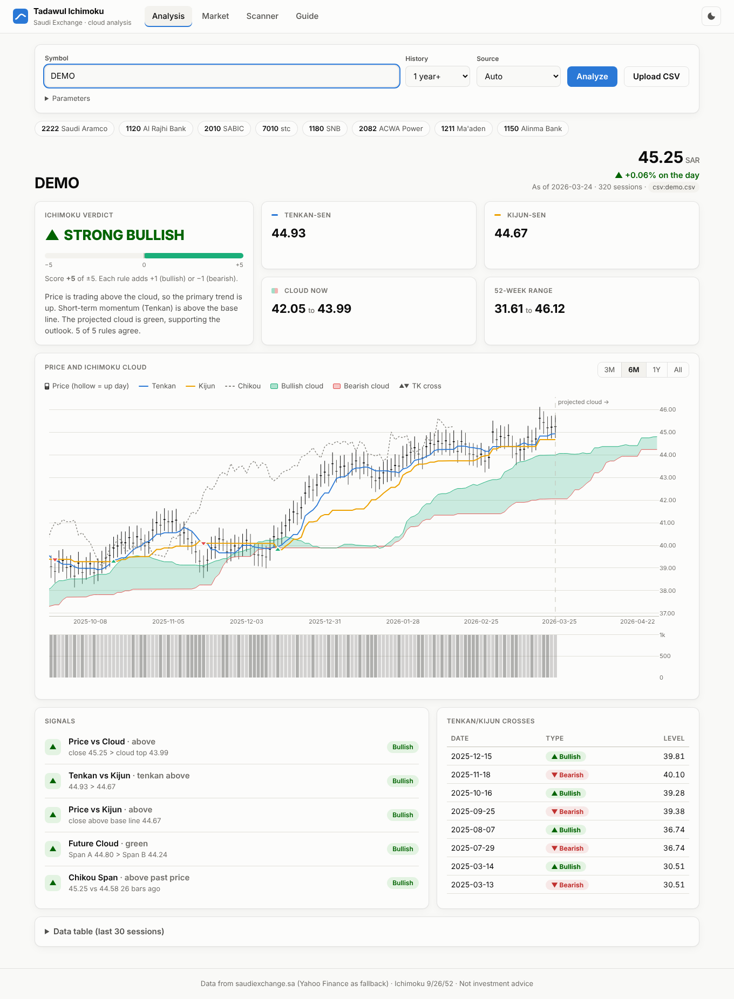

# Tadawul Ichimoku

Scrapes stock prices from the Saudi Exchange website (www.saudiexchange.sa) and runs an
Ichimoku Kinko Hyo analysis, with a text verdict and a chart.

## Install

```bash
pip install -r requirements.txt
```

## Usage

```bash
# Latest price of every listed company (from Tadawul's ticker feed)
python -m tadawul_ichimoku list
python -m tadawul_ichimoku list --top 10 --save snapshot.csv

# Ichimoku analysis (symbols are Tadawul codes)
python -m tadawul_ichimoku analyze 2222 --plot          # Saudi Aramco
python -m tadawul_ichimoku analyze 1120 2010 7010 --plot # Al Rajhi, SABIC, STC

# Choose the data source: auto (Tadawul first, then Yahoo 2222.SR), tadawul, yahoo
python -m tadawul_ichimoku analyze 2222 --source tadawul

# Analyse prices you already have (columns: date,open,high,low,close,volume)
python -m tadawul_ichimoku analyze 2222 --csv prices.csv --plot
```

Results go to `./output/`: `<sym>_prices.csv`, `<sym>_ichimoku.csv` (all indicator lines)
and `<sym>_ichimoku.png`.

## Web application

```bash
python -m tadawul_ichimoku serve            # http://127.0.0.1:5000
python -m tadawul_ichimoku serve --host 0.0.0.0 --port 8080
```

| Page | What it does |
|---|---|
| **Analysis** | Search a symbol (autocomplete from the live market list) or pick a popular one, choose the history length and data source, or upload a CSV. Shows the verdict with a −5..+5 meter, a plain-language summary, Tenkan/Kijun/cloud/52-week tiles, an interactive candlestick chart (cloud projected 26 sessions ahead, TK-cross markers, volume, 3M/6M/1Y/All zoom, hover crosshair), the five signals, recent TK crosses and a data table. |
| **Market** | Every listed company from the Tadawul ticker feed: filter, sort, advancing/declining counts, one-click *Analyze*. |
| **Scanner** | Ranks a watchlist (up to 30 symbols) by Ichimoku score, with a 60-session sparkline and a ▲/▼ per rule. |
| **Guide** | How each Ichimoku line is calculated and how the score works. |

Also supports light/dark themes (follows the OS, with a toggle), works on phones, and supports deep links
such as `/#analysis/2222`. Plotly is bundled in `static/vendor`, so no CDN is needed.

JSON API: `GET /api/analyze/<symbol>?days=&source=&tenkan=&kijun=&senkou_b=&displacement=`,
`POST /api/analyze-csv` (multipart `file`), `GET /api/market`, `GET /api/scan?symbols=2222,1120`.
Results are cached in memory (analysis 10 min, market 1 min).



*The screenshot uses synthetic test prices loaded from CSV, not real market data.*

## How the analysis works

| Line | Formula |
|---|---|
| Tenkan-sen | (9-day high + 9-day low) / 2 |
| Kijun-sen | (26-day high + 26-day low) / 2 |
| Senkou Span A | (Tenkan + Kijun) / 2, plotted 26 days ahead |
| Senkou Span B | (52-day high + 52-day low) / 2, plotted 26 days ahead |
| Chikou Span | close, plotted 26 days back |

Five rules each score +1 (bullish), −1 (bearish) or 0:

1. Price above / below / inside the cloud
2. Tenkan above / below Kijun (recent TK crosses are reported)
3. Price above / below Kijun
4. Colour of the future cloud (Span A vs Span B, 26 days ahead)
5. Chikou: today's close vs the close 26 days ago

Total ≥ +3 means STRONG BULLISH, +1..+2 BULLISH, 0 NEUTRAL, −1..−2 BEARISH, ≤ −3 STRONG BEARISH.
Periods can be changed with `--tenkan --kijun --senkou-b --displacement`.

At least 78 trading days are needed (52 + 26), so the default fetch is 400 calendar days.

## Scraper notes

* `TickerServlet` (JSON) gives the current quotes.
* Historical data comes from the company profile page's *Historical Data* portlet. Its URL
  holds a session token, so the scraper loads the profile page, finds that URL in the HTML,
  and POSTs to it.
* The site sits behind a WAF, and its layout changes now and then. If the Tadawul source
  breaks, `--source auto` falls back to Yahoo Finance. You can also export prices yourself
  and pass them with `--csv`.
* Please scrape politely: don't run it in a tight loop.

This is not investment advice.

## Deploying

See [DEPLOY.md](DEPLOY.md) to deploy to Cloudflare Containers.

## Tests

```bash
python -m pytest -q
```
